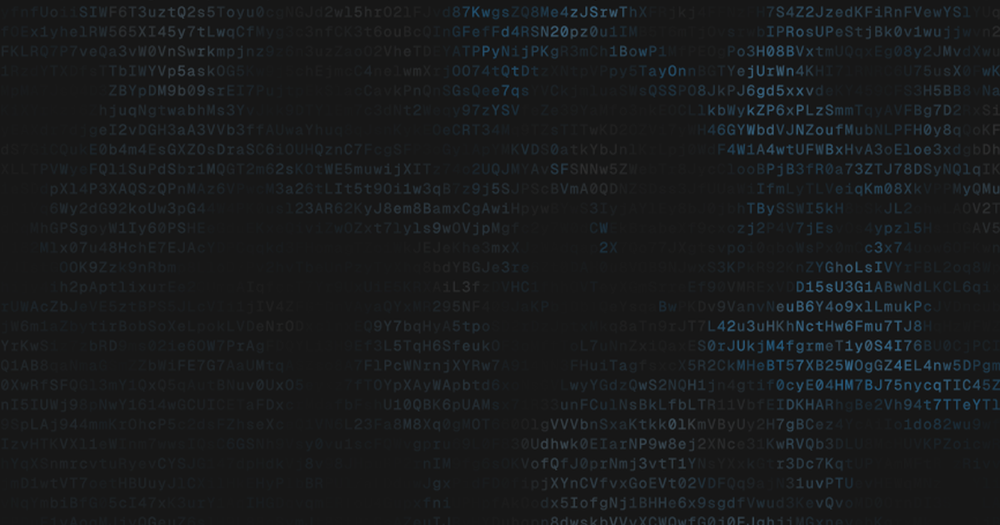

# Claude Code Water

An interactive recreation of Claude Code desktop's digital water animation: a fixed field of characters, faint gray currents, and blue ripples that spread, break apart, and settle.

**[Try the demo →](https://traddmccorkle.github.io/claude-code-water/)**



Built from a reference clip, with a small two-pass WebGL renderer. No framework, package install, build step, or external runtime requests. The font is bundled locally.

## Play with it

- Click or tap anywhere to drop a ripple.
- Choose **Reference sequence**, **Random drips**, or **Click to ripple**.
- **Space** pauses or plays; **H** hides the controls; **R** resets time.
- Drag the timeline to inspect a paused frame.
- **Save frame** previews a PNG of the canvas and provides a download link.
- Open `?t=3.0` for a frozen frame, `?ui=0` for a clean canvas, or `?mode=manual` for manual drops.

The demo starts paused when the system requests reduced motion.

## Run locally

```sh
python3 -m http.server 8000
```

Then open `http://localhost:8000`. A local server lets the browser load the bundled font reliably.

## Use the renderer

```html
<style>
  @font-face {
    font-family: 'Digital Mono';
    src: url('fonts/GeistMono-Regular.woff2') format('woff2');
  }
  #water { display: block; width: 100%; height: 500px; }
</style>
<canvas id="water"></canvas>
<script src="waves.js"></script>
<script>
  document.fonts.load('12.5px "Digital Mono"').then(() => {
    const waves = DigitalWaves.create(document.querySelector('#water'), {
      mode: 'manual'
    });
    waves.drop(200, 300); // CSS pixels from the canvas's top-left corner
    // waves.destroy(); // when the view unmounts
  });
</script>
```

| API | Behavior |
| --- | --- |
| `drop(x, y, strength = 1)` | Add a ripple; strength is clamped to 0–2. |
| `seek(seconds)` | Set time and clear manual drops. |
| `pause()` / `play()` | Stop or resume time. |
| `setMode('sequence' \| 'random' \| 'manual')` | Change mode and reset time. |
| `render()` | Redraw the current state. |
| `capture()` | Render and return a lossless PNG data URL. |
| `destroy()` | Release GPU resources and event listeners. |
| `time`, `paused`, `mode` | Read current state. |

Options: `mode`, `time`, `paused`, `interactive`, `seed`, `cellWidth`, `cellHeight`, `fontSize`, `fontFamily`, `maxPixelRatio`, and `scale`. Use `interactive: false` to trigger drops only through your application's events.

The default grid is 8.5 × 17 CSS pixels. Ripple distances adapt to a reference area of 866 × 734; use `scale: 1` to keep distances fixed in CSS pixels. The renderer supports up to 24 active drops and rebuilds its resources after WebGL context restoration.

## How it works

The first GPU pass evaluates ambient noise, refracted wave fronts, fragmented blue wakes, and slower gray decay once per character cell. The second pass samples those values and a character atlas to draw the canvas. Lit cells update their glyphs faster; the grid stays still.

The recreation was refined against frames at 1.5, 3.0, and 5.8 seconds, including direct PNG exports to avoid browser screenshot compression affecting the comparison. The late drop is deliberately weaker to better match the reference sequence.

## Reference and limits

Inspired by the animation shown in [the Claude Developers post](https://x.com/ClaudeDevs/status/2110445844675838148) and [this example](https://x.com/ziwenxu_/status/2110453980832608626).

This is an independent visual recreation, not Anthropic's source code or an exact frame-for-frame match. Noise patterns, characters, and detailed wave shapes differ. The original font and shader were unavailable. It reproduces the water effect, not the surrounding app interface. This project is not affiliated with Anthropic.

[Geist Mono](https://github.com/vercel/geist-font) supplies consistent lettering across platforms. It is an approximation of the reference typography, not a confirmed identification of the original font.

## License

Code: [MIT](LICENSE). Bundled font: [SIL Open Font License 1.1](fonts/OFL.txt).
